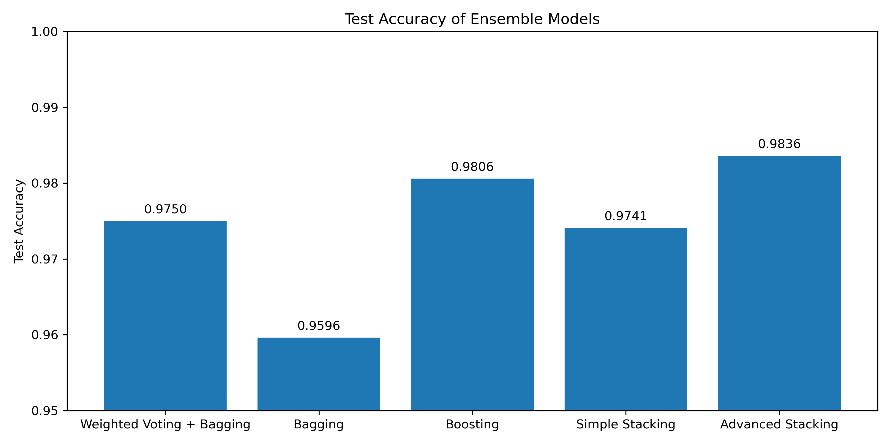

# MNIST Classification: Classical Ensembles vs. CNNs

How far can classical machine learning go on handwritten digit classification, and how robust is it compared to CNNs?

Group project for the **Künstliche Intelligenz 1** module, M.Sc. Data Science, Justus-Liebig-Universität Gießen.

## Team and Division of Work

All team members worked on the same preprocessed data (`00_process_data.ipynb`: normalization and a shared
train/validation/test split), so that every model was trained and evaluated under identical conditions.
Each member then explored a different set of models in their own notebook and saved the evaluation metrics as
`.json` files in `results/`. The best classical models were finally compared with CNN models trained during the course.

| Member                   | Notebook                          | Work |
|--------------------------|-----------------------------------|------|
| **Leyla Louache**        | `01_leyla.louache.ipynb`          | Voting, bagging, boosting and stacking ensembles; robustness analysis vs. CNNs |
| Lucas Tetic-Seiwerth     | `02_Tetic-Seiwerth.Lucas.ipynb`   | Knn |
| Seyedeh Sara Ghadiri     | `03_Ghadiri.Seyedeh.Sara.ipynb`   | Logistic Regression |
| Mohamed Eltantawy        | `04_Eltantawy.Mohamed.ipynb`      | Decision Tree |

---

# My Contribution: `notebooks/01_leyla.louache.ipynb`

## 1. Best Model per Ensemble Category

Starting from three tuned base models (Decision Tree, kNN, Logistic Regression), I explored four families of
ensemble methods:

- **Voting:** hard, soft and weighted soft voting
- **Bagging:** applied to each base model; it strongly improved the high-variance Decision Tree and brought almost
  nothing to kNN and LR, so it was kept only for the tree
- **Boosting and tree ensembles:** Random Forest, Extra Trees, AdaBoost, Gradient Boosting, Histogram Gradient Boosting
- **Stacking:** several combinations of base learners and meta-learners

| Category                  | Best configuration                          | Validation accuracy |
|---------------------------|---------------------------------------------|--------------------:|
| Weighted voting + bagging | Bagged Tree + kNN + LR (weights = [2,3,1])  | 97.38% |
| Bagging                   | Random Forest                               | 95.58% |
| Boosting                  | Histogram Gradient Boosting                 | 97.97% |
| Simple stacking           | Tree + kNN + LR → LR                        | 97.55% |
| **Advanced stacking**     | **kNN + HGB → LR**                          | **98.12%** |

On the test set, the advanced stacking model is the best classical model with **98.36% accuracy**,
followed by Histogram Gradient Boosting (98.06%).



## 2. Robustness: Stacking vs. CNNs under Spatial Perturbations

The stacking model was compared with four CNN models that were **trained by the professor during the course**
and provided as `.keras` files (`models/`). All models were evaluated on the clean test set and on perturbed
versions of it: small shifts, large shifts, rotations and a mix of these transformations.

| Model                                  | Clean  | Small shift | Large shift | Rotation | Mixed  |
|----------------------------------------|-------:|------------:|------------:|---------:|-------:|
| Stacking                               | 97.41% | 77.23%      | **32.31%**  | 91.44%   | 88.89% |
| CNN                                    | 98.51% | 90.44%      | 48.98%      | 92.19%   | 93.75% |
| CNN + dropout                          | 99.06% | 92.51%      | 51.11%      | 94.44%   | 95.36% |
| CNN + dropout + shift augmentation     | 98.60% | 98.21%      | 96.39%      | 92.61%   | 96.67% |
| CNN + dropout + full augmentation      | 98.96% | **98.28%**  | **96.46%**  | **98.12%** | **98.53%** |

**Findings**
- On clean data, the stacking model is competitive with the CNNs.
- Under spatial perturbations it breaks down: classical models work on fixed pixel positions, so shifting a digit
  by a few pixels drops the accuracy from 97% to 32%.
- CNNs are more robust, but only **data augmentation** makes them truly robust: without it, even CNNs fall to
  about 50% on large shifts.

**Takeaway:** high accuracy on a clean benchmark does not imply robustness.

---

## Project Structure

```
notebooks/
├── 00_process_data.ipynb            # load, normalize and split MNIST, saved to processed/
├── 01_leyla.louache.ipynb
├── 02_Tetic-Seiwerth.Lucas.ipynb
├── 03_Ghadiri.Seyedeh.Sara.ipynb
└── 04_Eltantawy.Mohamed.ipynb
models/                              # CNN models trained during the course (.keras)
results/
├── *.json                           # evaluation metrics from notebooks 01–04
└── final_comparison.ipynb           # final comparison of ensembles and CNNs
plot/                                # all generated figures
```

## How to Run

1. Run `notebooks/00_process_data.ipynb` to create the `processed/` folder
2. Run the model notebooks `01` to `04`
3. Run `results/final_comparison.ipynb`

All metrics are already stored in `results/`, so the final comparison can be reproduced directly with step 3.

## Tech Stack

Python · scikit-learn · TensorFlow / Keras · NumPy · pandas · Matplotlib`results/final_comparison.ipynb`, without rerunning the previous experiments.
